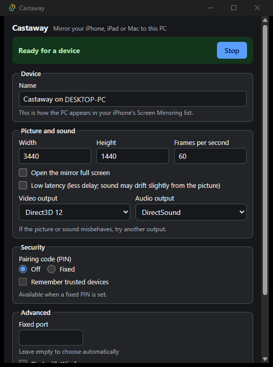

<p align="center"></p>

# Castaway

Turn a Windows PC into an AirPlay receiver. Mirror an iPhone, iPad or Mac screen (video and audio) to a window on your PC.

Castaway is a small tray app (Tauri 2, Rust, plain TypeScript UI) wrapped around [UxPlay](https://github.com/FDH2/UxPlay), which does the actual AirPlay work. Castaway adds what UxPlay lacks on Windows: an installer, a tray icon, a settings window, automatic restarts, and plain-language explanations when something stops it from working.



This is a personal portfolio project. It is free software, provided as is.

## Install

1. Download `Castaway_x.y.z_x64-setup.exe` from the [latest release](https://github.com/ketiaaa/castaway/releases/latest).
2. Run it and approve the Windows admin prompt. The installer adds a Windows Firewall rule for the streaming engine (Private networks only).
3. Make sure your Wi-Fi is set to **Private** (Windows Settings > Network & internet > your Wi-Fi > Network profile type). Castaway tells you if it isn't.
4. On your iPhone, open Control Centre > Screen Mirroring and pick **Castaway on <your PC name>**.

The installer is not code-signed, so Windows SmartScreen may warn about an unknown publisher. Choose More info > Run anyway.

Requirements: Windows 10 or 11 (x64), and the PC and the Apple device on the same network.

## Features

- Tray icon with Start, Stop and Restart, plus a status window (Ready, Connected to a device, or what is wrong).
- Settings: device name, resolution, frame rate, fullscreen, video and audio output, fixed PIN, remembering trusted devices, fixed port, start with Windows, and a **Low latency** mode.
- The mirror window carries the Castaway title, icon and a dark title bar.
- Restarts the streaming engine automatically if it crashes.
- Checks for problems and explains them: firewall rule, Public network profile, ports already in use, missing components.
- Updates itself. Castaway checks GitHub on start (and from the **Check for updates** button) and only installs updates signed with the project's key.

## Notes

- Low latency shows the picture immediately instead of syncing it to the audio. Less delay, but sound can drift slightly from the picture.
- Device names must be plain ASCII (a limitation of the Windows UxPlay build).
- Windows only, x64 only.

## Build from source

You need Node.js, Rust, and MSYS2 (UCRT64) with UxPlay's build dependencies.

```powershell
npm install
powershell -ExecutionPolicy Bypass -File scripts\build-uxplay.ps1   # builds uxplay.exe + GStreamer runtime into src-tauri\resources\uxplay
npm test                      # UI tests
cd src-tauri; cargo test; cd ..
npm run tauri build           # installer in src-tauri\target\release\bundle\nsis
```

The `resources\uxplay` bundle is built locally and is not stored in git. See [docs/releasing.md](docs/releasing.md) for how releases are signed and published, and [docs/verification.md](docs/verification.md) for the manual test checklist.

## Licence and credits

Castaway is licensed under the GNU GPL v3 or later (see [LICENSE](LICENSE)).

It bundles [UxPlay](https://github.com/FDH2/UxPlay) (GPL-3.0) and a GStreamer runtime with other third-party components. Their licences and where to get their source are listed in [THIRD-PARTY-NOTICES.txt](src-tauri/resources/THIRD-PARTY-NOTICES.txt) and [SOURCE.txt](src-tauri/resources/SOURCE.txt).

"AirPlay", "iPhone", "iPad" and "Mac" are trademarks of Apple Inc. Castaway is not affiliated with or endorsed by Apple.
